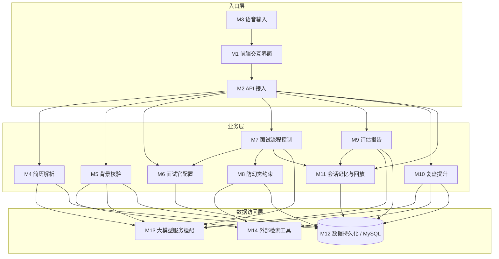

# InterviewerAgent 模块划分报告（初稿）

> 依据：《需求分析.md》中的功能性需求、技术需求、业务流程（主流程图）与数据流图（P1–P4 / D1–D4）。
> 本稿完成三项内容：① 功能编号与模块清单；② 层次框图草稿；③ 功能—程序矩阵。

---

## 一、功能编号（F1–F20）

由需求分析逐条提取功能点并编号，"优先级"沿用需求分析中"必须 / 可选"的划分。

| 编号 | 功能 | 来源 | 优先级 |
| --- | --- | --- | --- |
| F1 | 简历上传（PDF / DOCX / TXT / MD） | 功能性需求 | 必须 |
| F2 | 简历文本解析，生成结构化用户画像 | 功能性需求、P1 | 必须 |
| F3 | 人工确认 / 修改画像 | 需求优先级 | 可选 |
| F4 | 提交项目地址，查询代码仓库信息（GitHub） | 业务流程、技术需求 | 必须 |
| F5 | 全网信息检索与网页（博客）内容抓取 | 技术需求 | 必须 |
| F6 | 比对简历自述，生成核验条目并标记状态（已验证 / 矛盾 / 可疑 / 无法核验），保存佐证材料 | 功能性需求、P2 | 必须 |
| F7 | 面试官人设配置与面试难度设置 | 功能性需求 | 可选 |
| F8 | 按岗位类型（后端 / 前端 / 算法等）调整面试侧重点 | 辅助功能 | 可选 |
| F9 | 五阶段面试流程控制（开场 → 项目深挖 → 原理追问 → 挑战提问 → 收尾） | 功能性需求、P3 | 必须 |
| F10 | 流式输出，逐字推送面试官发言 | 功能性需求、非功能 2 | 必须 |
| F11 | 防幻觉约束：提问必须引用真实证据，检测并修正虚构问题 | 功能性需求、非功能 4 | 必须 |
| F12 | 检测用户回答并决定是否追问 | 主流程图 | 必须 |
| F13 | 麦克风语音转文字作答 | 辅助功能 | 可选 |
| F14 | 面试中断后刷新页面恢复对话 | 功能性需求 | 必须 |
| F15 | 生成多维度评估报告（附引文来源、改进计划、雷达图） | 功能性需求、P4 | 必须（雷达图可选） |
| F16 | 汇总面试错题集并附知识点参考资料 | 辅助功能 | 可选 |
| F17 | 根据核验问题生成简历优化建议 | 辅助功能 | 可选 |
| F18 | 持久化用户画像、核验条目、风险标记、对话历史（MySQL） | 功能性需求、D1–D4 | 必须 |
| F19 | 面试记录回放 | 技术需求 | 可选 |
| F20 | 切换不同大模型服务（OpenAI 兼容协议） | 非功能 3 | 必须 |

---

## 二、模块清单（M1–M14）

按"入口层 → 业务层 → 数据访问层"三层归组，共 14 个模块，每个模块一句话职责。

### 入口层

| 编号 | 模块 | 职责 |
| --- | --- | --- |
| M1 | 前端交互界面 | 提供简历上传、画像确认、面试对话、报告查看与回放等页面，并渲染流式文本。 |
| M2 | API 接入模块 | 基于 FastAPI 对外暴露 HTTP / SSE 接口，校验上传文件并把请求分发给各业务模块。 |
| M3 | 语音输入模块 | 采集麦克风音频并转写为文字，作为用户回答交给面试对话流程。 |

### 业务层

| 编号 | 模块 | 职责 |
| --- | --- | --- |
| M4 | 简历解析模块 | 抽取多格式简历文本，调用大模型生成结构化画像（对应 P1）。 |
| M5 | 背景核验模块 | 以 ReAct 方式调用检索工具收集外部证据，逐条比对简历陈述并生成带状态的核验条目（对应 P2）。 |
| M6 | 面试官配置模块 | 根据人设、难度、岗位类型和核验结果生成面试官提示词与提问方向清单。 |
| M7 | 面试流程控制模块 | 以状态机驱动五阶段面试，负责出题、判断追问、切换阶段并流式输出（对应 P3）。 |
| M8 | 防幻觉约束模块 | 校验每个问题是否有画像或核验证据支撑，必要时调用工具修正问题，并检测回答中的虚构信息。 |
| M9 | 评估报告模块 | 汇总对话记录与核验条目，生成带引文的多维度评分、雷达图数据和改进计划（对应 P4）。 |
| M10 | 复盘提升模块 | 从对话中挑出回答有缺陷的问题生成错题集与参考资料，并输出简历优化建议。 |
| M11 | 会话记忆与回放模块 | 管理短期对话窗口与长期面试档案，支持断线恢复和按时间线回放面试。 |

### 数据访问层

| 编号 | 模块 | 职责 |
| --- | --- | --- |
| M12 | 数据持久化模块 | 基于 SQLAlchemy + MySQL 存取画像、核验条目、风险标记、对话记录与报告（D1–D4）。 |
| M13 | 大模型服务适配模块 | 统一封装 OpenAI 兼容协议的 LLM 调用，提供流式、超时重试，并支持通过配置切换模型。 |
| M14 | 外部检索工具模块 | 封装 GitHub 仓库查询、Tavily 全网检索与网页正文抓取，作为 Agent 可调用的工具。 |

---

## 三、层次框图（草稿）

连线方向表示"调用"。

**与数据流图的对应关系：**

| 数据流图元素 | 承担模块 |
| --- | --- |
| P1 简历解析 | M4（+ M13） |
| P2 联网核验 | M5（+ M14、M13） |
| P3 面试对话 | M7（+ M6、M8、M11、M13） |
| P4 报告生成 | M9（+ M13） |
| D1 画像结果 / D2 核验条目 / D3 对话记录 / D4 报告 | M12 |
| 外部实体 GitHub、Tavily | M14 |
| 外部实体 大模型服务 | M13 |
| 外部实体 用户 | M1、M2、M3 |

---

## 四、功能—程序矩阵

● 表示该模块参与实现该功能。★ 标出的三行为核心功能（简历解析、联网核验、多阶段面试），优先完成。

| 功能 \ 模块 | M1 | M2 | M3 | M4 | M5 | M6 | M7 | M8 | M9 | M10 | M11 | M12 | M13 | M14 |
| --- | :-: | :-: | :-: | :-: | :-: | :-: | :-: | :-: | :-: | :-: | :-: | :-: | :-: | :-: |
| F1 简历上传 | ● | ● | | ● | | | | | | | | | | |
| ★ F2 简历解析与画像 | | ● | | ● | | | | | | | | ● | ● | |
| F3 人工确认画像 | ● | ● | | | | | | | | | | ● | | |
| F4 仓库信息查询 | ● | ● | | | ● | | | | | | | | | ● |
| F5 全网检索与网页抓取 | | | | | ● | | | | | | | | | ● |
| ★ F6 核验条目生成与状态标记 | | ● | | | ● | | | | | | | ● | ● | ● |
| F7 人设与难度配置 | ● | ● | | | | ● | | | | | | | | |
| F8 岗位类型区分 | ● | | | | | ● | | | | | | | | |
| ★ F9 五阶段面试流程控制 | ● | ● | | | | ● | ● | ● | | | ● | ● | ● | |
| F10 流式输出 | ● | ● | | | | | ● | | | | | | ● | |
| F11 防幻觉约束 | | | | | | | ● | ● | | | | ● | ● | ● |
| F12 回答检测与追问 | | | | | | | ● | ● | | | | | ● | |
| F13 语音输入 | ● | | ● | | | | | | | | | | | |
| F14 中断恢复 | ● | ● | | | | | | | | | ● | ● | | |
| F15 评估报告 | ● | ● | | | | | | | ● | | ● | ● | ● | |
| F16 面试错题集 | ● | ● | | | | | | | | ● | | ● | ● | ● |
| F17 简历优化建议 | ● | ● | | | | | | | | ● | | ● | ● | |
| F18 数据持久化 | | | | | | | | | | | ● | ● | | |
| F19 面试回放 | ● | ● | | | | | | | | | ● | ● | | |
| F20 大模型切换 | | | | | | | | | | | | | ● | |

**检查结果：**

1. 每一行（F1–F20）至少有一个 ●，所有功能都有模块认领。
2. 每一列（M1–M14）至少有一个 ●，没有空转模块。
3. 核心功能 F2、F6、F9 分别由 M4、M5、M7 主责，与数据流图 P1、P2、P3 一一对应，划分方向与需求分析一致。

---

## 五、待评审 / 待完善事项

- M6 面试官配置与 M7 面试流程控制的边界：提问方向清单由 M6 一次性生成，还是由 M7 在每个阶段动态生成，需在概要设计中确定。
- M8 防幻觉约束目前同时负责"问题校验"和"回答检测"，若实现复杂度过高，可拆分为两个子模块。
- 可选功能（F3、F7、F8、F13、F16、F17、F19）对应的 M3、M10 可在后期迭代实现，不影响主流程。
- 完整初稿课后一周内补充：各模块接口说明、模块间数据结构定义，随后并入项目报告。
